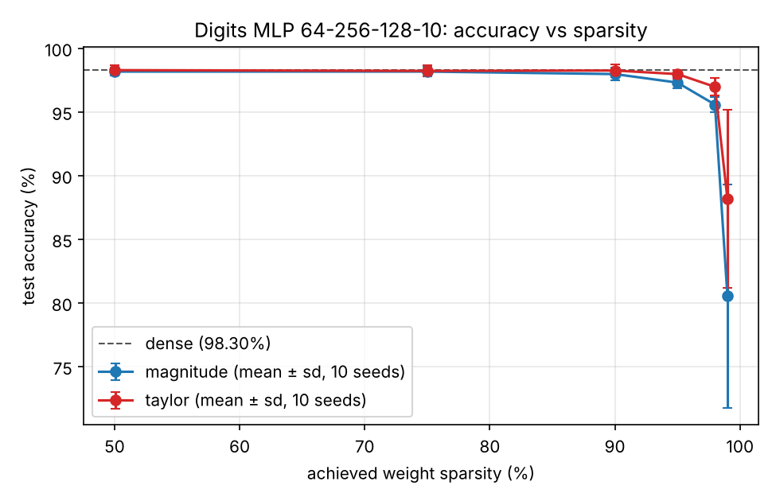

# sparse-nn

A small NumPy-only neural-network framework: reverse-mode autodiff, an MLP, mask-aware Adam,
progressive pruning (magnitude baseline vs. a Taylor/Fisher sensitivity criterion), and a
sparse-aware inference path whose cost is measured, not assumed.

## Layout

| Path | Contents |
|---|---|
| `engine/tensor.py` | `Tensor`, broadcasting-aware ops (`+ - * / @`, `sum`, `mean`, `relu`, `tanh`, `sigmoid`), `softmax_cross_entropy`, topological `backward()` |
| `nn/layers.py` | `Linear` (with `W.mask`), `ReLU`, `Tanh`, `Sequential`, `mlp()` |
| `optim/adam.py` | Adam with per-element state and per-element step counter, mask-aware |
| `prune/pruner.py` | importance scores, cubic schedule, `Pruner`, RigL-style `regrow()` |
| `prune/sparse_infer.py` | exact dead-unit compaction + non-zero-only gather kernel |
| `train/` | data loading, training loop, CLI |
| `tests/` | gradient checks, masking/optimizer regression tests, end-to-end tests |
| `experiments/` | sweep + benchmark scripts; `results/` holds raw CSV/JSON and plots |

See [DESIGN.md](DESIGN.md) for derivations and design decisions.

## Install

Python ≥ 3.10.

```bash
python -m venv .venv && source .venv/bin/activate
pip install -r requirements.txt     # numpy, matplotlib, scikit-learn
```

scikit-learn is used **only** in `train/data.py` to load the bundled 8×8 digits dataset
(1,797 images, 10 classes; no download). Everything else is NumPy. Tests use stdlib `unittest`.

## Commands (run from the repo root)

```bash
python -m unittest discover -s tests -t . -v      # all tests (~2 s)
python -m unittest tests.test_gradcheck -v        # gradient checks only
python -m unittest tests.test_masking -v          # mask / Adam / regrowth regression

python -m train.run                               # dense baseline
python -m train.run --method taylor --target 0.95 # dynamic pruning (primary method)
python -m train.run --method magnitude --target 0.95

python -m experiments.sweep                       # 130 runs, ~5 min on 2 cores
python -m experiments.benchmark                   # latency / MACs / memory
```

## Configuration and seeds

* Model: MLP 64-256-128-10, ReLU, He-normal init (`N(0, 2/fan_in)`), zero biases.
* Adam lr 2e-3, β=(0.9, 0.999), batch 64, 40 epochs (23 steps/epoch).
* Pruning: layer-wise (every `Linear`, including the output layer, pruned to the same fraction),
  cubic schedule from 0 at epoch 5 to the target at epoch 30, mask update once per epoch,
  10 fine-tuning epochs at fixed sparsity. Biases are never pruned.
* Data: fixed 80/20 split (`split_seed=0`, 1,438 train / 359 test), standardised with train statistics.
* `--seed` / sweep seeds 0–9 control weight init and mini-batch order. The same seed gives
  bit-identical results (tested), and magnitude vs. Taylor runs with the same seed share init
  and batch order, so comparisons are **paired**.

## Results

### Sparsity vs. accuracy (10 seeds, test accuracy %, mean ± sd)
Source: `experiments/results/summary.json`, `sweep_runs.csv`, `accuracy_vs_sparsity.png`.
Dense baseline: **98.30 ± 0.33**. Achieved sparsity matches the target in every run (to rounding).

| Target sparsity | Magnitude | Taylor (primary) | Paired Δ (Taylor − Mag.), 95% CI | Taylor better / tie |
|---|---|---|---|---|
| 50% | 98.16 ± 0.33 | 98.27 ± 0.37 | +0.11 [−0.16, +0.38] | 4 / 3 of 10 |
| 75% | 98.16 ± 0.40 | 98.22 ± 0.46 | +0.06 [−0.29, +0.40] | 3 / 4 |
| 90% | 97.97 ± 0.49 | 98.25 ± 0.49 | +0.28 [−0.19, +0.75] | 6 / 2 |
| 95% | 97.30 ± 0.42 | 97.97 ± 0.35 | **+0.67 [+0.35, +0.98]** | 8 / 2 |
| 98% | 95.57 ± 0.61 | 96.96 ± 0.70 | **+1.39 [+0.82, +1.96]** | 10 / 0 |
| 99% | 80.53 ± 8.76 | 88.16 ± 7.00 | +7.63 [−0.63, +15.89] | 8 / 0 |



**Quantitative claim (falsifiable).** At 98% weight sparsity on this setup, Taylor/Fisher pruning
reaches 96.96 ± 0.70% test accuracy vs. 95.57 ± 0.61% for magnitude pruning over 10 paired seeds;
the paired difference is +1.39 pp (95% t-interval [+0.82, +1.96], t = 5.5, Taylor higher on 10/10
seeds). At ≤ 90% sparsity the methods are statistically indistinguishable here and both are within
~0.3 pp of dense. The claim is falsified if re-running `python -m experiments.sweep` yields a paired
CI at 98% that includes 0.

### Computation (seed 0, Taylor-pruned models)
Source: `experiments/results/efficiency.json`, `latency.png`. MACs count weight multiplies per example.
Latency: median µs, NumPy, 1 BLAS thread, cloud VM (noisy; compare ratios, not absolutes).

| Sparsity | Acc % | Active / total params | MACs dense | MACs sparse kernel | MACs compact-dense | Hidden units | Weight memory KiB dense / sparse | Latency B=1: dense / compact / sparse | Latency B=1024 |
|---|---|---|---|---|---|---|---|---|---|
| 0% | 98.05 | 50,826 / 50,826 | 50,432 | 50,432 | 50,432 | 256, 128 | 397 / 797 | 15.8 / 15.2 / 169 | 3674 / 3368 / 779070 |
| 90% | 98.33 | 5,437 / 50,826 | 50,432 | 5,039 | 27,050 | 185, 78 | 397 / 85 | 13.6 / 12.2 / 42 | 3238 / 2094 / 52637 |
| 95% | 98.33 | 2,915 / 50,826 | 50,432 | 2,445 | 15,383 | 137, 45 | 397 / 43 | 15.6 / 9.6 / 33 | 3369 / 1351 / 27077 |
| 98% | 97.77 | 1,403 / 50,826 | 50,432 | 861 | 6,842 | 76, 23 | 397 / 16 | 14.8 / 9.3 / 27 | 3177 / 710 / 7931 |

What this shows, stated carefully:

* **Theoretical reduction:** at 95% sparsity the non-zero kernel performs 2,445 MACs/example vs
  50,432 dense (20.6× fewer); compaction alone removes 69% of MACs (dead units are folded out exactly).
* **Measured runtime:** the *compact-dense* path is genuinely faster — 1.6× at batch 1 and
  2.5× at batch 1024 for 95% sparsity; 4.5× at batch 1024 for 98%.
* The **unstructured non-zero kernel is slower than dense BLAS** at every sparsity measured, despite
  doing 10–60× less arithmetic: in pure NumPy, gathers and `reduceat` cost far more per operation than
  a BLAS GEMM. Its value here is the memory footprint (16 KiB vs 397 KiB at 98%) and as a correct
  reference. No speedup claim is made for it.
* The dense path with masked weights does not get faster with sparsity (flat ~15 µs / ~3.4 ms), as expected.

## Known limitations

* Digits is small and easy; differences between criteria only appear at ≥ 95% sparsity. Results may
  not transfer to larger datasets/models.
* One fixed train/test split, no separate validation set; hyperparameters were set once by hand,
  not tuned on the test set, but the test set is reused across all reported numbers.
* 10 seeds; CIs use a Student-t approximation on paired differences (test accuracy is discrete in
  steps of 0.28 pp).
* Unstructured sparsity in pure NumPy cannot beat BLAS; real speedups need a compiled kernel
  or structured (unit/block) sparsity — compaction is a small step in that direction.
* `regrow()` is implemented and tested but not used in the reported experiments (masks are monotone).
* The autodiff engine is single-threaded, float64, and rebuilds the graph each step (see DESIGN.md §4).
